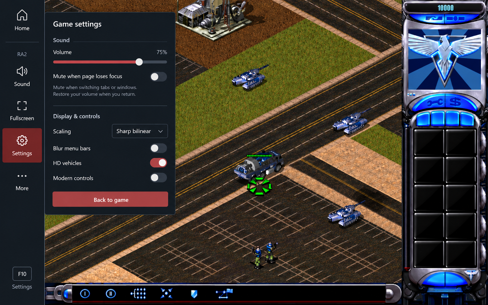
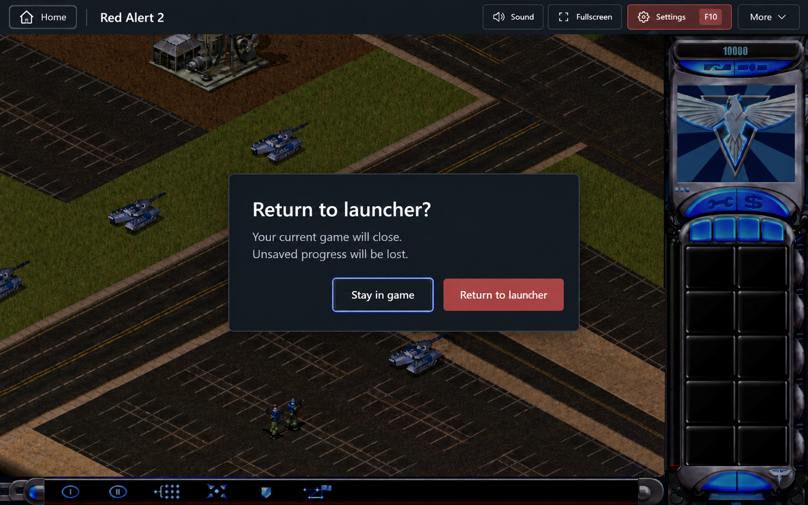

# Running Game Sidebar Design

Date: 2026-10-25. Status: design recorded; implementation not started.

## Intent and scope

Consolidate the browser controls around a running RA2 or Yuri's Revenge session into a left sidebar. Make common actions easy to find while preserving game space. Include a confirmed return to the launcher and an optional mute-on-focus-loss setting.

This document records the design discussed with the user. The user requested documentation only; creating this document does not authorize implementation. Exact dimensions, timing, storage keys, and component boundaries below are proposed implementation defaults, rather than separately approved visual details.

## Approaches considered

- A permanent top bar makes controls easy to find but consumes vertical game space. This was the first prototype.
- A permanent labeled left sidebar preserves vertical space but consumes horizontal space. This was the second prototype.
- A compact left rail that expands on hover or focus and can be pinned is the selected direction. It combines discoverability with adjustable space usage.

Adjustable means compact/expanded/pinned states in this version. Freeform drag resizing, moving the sidebar to another edge, and completely hiding its activation area are outside scope.

## Sidebar layout and interaction

Keep the existing Radix dark slate theme, red accent, small corners, and typography. No new dependencies or theme replacement. Controls become fully opaque during interaction; icons have accessible names and visible keyboard focus.

| Item | Behavior |
| --- | --- |
| Home | Open the return-to-launcher confirmation. |
| Sound | Open volume controls; offer Enable sound when browser activation is required. |
| Fullscreen | Toggle fullscreen and expose the current state. |
| Settings | Open Game settings; retain F10. |
| More | Keyboard input/Hide keyboard, Multiplayer (LAN), Browse files when available, and a shortcut guide. |
| Pin sidebar / Unpin sidebar | Persist the preferred expanded/compact mode. |

Use a 56 px compact rail and 184 px expanded sidebar, with targets at least 44 px high. Order Home first, then Sound, Fullscreen, Settings, More; place Pin near the bottom. These are starting layout values, not measurements inferred from generated images.

| State | Entry | Geometry and exit |
| --- | --- | --- |
| Compact | Default when unpinned | Icons remain visible; reserve 56 px beside the game. |
| Temporarily expanded | Pointer enters the rail, keyboard focus enters, or the touch expand button is tapped | Reveal labels to 184 px, overlaying the additional 128 px of game without changing its canvas bounds. |
| Pinned | Player chooses Pin sidebar | Reserve 184 px beside the game; remain expanded until unpinned. |

Expand immediately. Collapse temporary expansion 250 ms after pointer and keyboard focus have both left, provided no owned menu/dialog or touch expansion remains open. Cancel the timer on re-entry; clear timers on unmount. A control's portaled popover counts as inside the interaction even though it is outside the sidebar DOM subtree.

On touch/coarse pointers, use a named Expand sidebar/Collapse sidebar button rather than relying on hover. Tapping action icons still performs their labeled actions. The explicit collapse button closes temporary touch expansion. On viewports below 768 px, keep a 56 px reserved rail even if pinning is preferred; expansion overlays the game, and the saved desktop pin preference is retained. Expanded content must fit within the viewport. Allow vertical scrolling on short screens; prevent horizontal page scrolling and clipped controls.

Use a short width/label transition of at most 150 ms. Start the rail at 20% opacity. Hover or keyboard focus fades it in over 0.3 seconds; after one second without sidebar interaction, fade it out to 20% over five seconds. Use a linear fade-out so the long transition feels gradual. Menus and dialogs keep it awake, including portaled content. Pinned rails also fade when idle. Mouse clicks must not leave a stale focus flag that prevents fading; actual keyboard focus must keep controls readable. Disable transitions and panel entrance animations with prefers-reduced-motion.

Hover expansion never changes canvas geometry. Pinning may change canvas geometry once, with ResizeObserver updating the game normally. Below 768 px, a saved desktop pin preference must not force the rail to remain expanded; retain the explicit touch expand/collapse action. The rail stays available in fullscreen as well as windowed mode.

## Pointer, keyboard, and canvas ownership

- Pointer lock belongs to gameplay. Moving toward the game's left edge must not expand the sidebar or release lock. Esc retains its existing browser/game behavior; after release, the player can reach the rail.
- Focus on host controls, or an open host menu/dialog, prevents pointer recapture and blocks gameplay keys/clicks from leaking through. Release held game inputs when control ownership changes. Closing a nested menu restores focus to its sidebar trigger; Back to game/canceling Home returns focus to the canvas after the host UI closes. A canvas click is the normal explicit way to recapture the pointer.
- Preserve F10, F11/Alt+Enter, F12, text/IME input, and the existing in-game Exit Game confirmation. Do not install a global Esc handler that swallows the game's key while no host overlay is open.
- Do not promise that host settings or navigation confirmation pause multiplayer. Preserve the game's existing focus/pause behavior.
- Keep the canvas mounted across sidebar state changes. Backdrop and loading/error surfaces must use the game viewport. Keep the software cursor in a stage-level overlay using viewport coordinates, since Presenter currently includes canvas.getBoundingClientRect().left/top in cursor positions. Moving that cursor into an offset parent would add the sidebar offset twice.

## Home confirmation and navigation

Home opens one modal with this exact copy:

> **Return to launcher?**
>
> Your current game will close.
> Unsaved progress will be lost.

Buttons: **Stay in game** (neutral; initial focus) and **Return to launcher** (red). Esc cancels; clicking outside must not confirm or dismiss. Trap modal focus. Cancel returns to the current game without navigation or a save flush.

Confirmation uses the existing leaveGame session/document-navigation path and its deployment-base-aware launcher destination. Do not switch to the launcher with client-only route navigation, create another runtime, or synthesize the game's own Exit Game reply. Saved files must be flushed before the document leaves; flushing existing saved files does not save the current match automatically.

During navigation show Returning to launcher..., disable repeat confirmation, and prevent new gameplay input. If the flush fails, stay in the current document, show an inline error, and offer Retry and Stay in game. Save polling must still work if the player cancels after failure. In the current implementation leaveGame stops polling before flushing, so change that ordering to stop only after a successful flush. Keep normal terminal exit and mod restart behavior covered by regression tests.

Keep Home confirmation separate from the runtime-requested Exit game? dialog. Only one modal may own input at a time: Home is unavailable while the native exit request is pending, and a native request arriving during Home closes the Home modal and takes priority. A successful normal game exit follows the existing return path without a second Home confirmation.

## Sound and focus setting

Add a Sound section to Game settings containing the current volume slider and this switch:

- Label: **Mute when page loses focus**.
- Helper: **Mute when switching tabs or windows. Restore your volume when you return.**
- Default: off. Persist the choice across launches, shared across editions and installations like the existing global volume preference.

Mute when enabled and either the document is hidden or the browser document lacks focus. Recompute from document.visibilityState and document.hasFocus() on visibilitychange, window focus, and window blur; evaluate immediately on attachment and preference changes. Clicking Settings, Sound, or another control within the same page is not page focus loss.

Keep the stored user volume separate from temporary focus muting. Use a browser output GainNode after the AudioWorkletNode with gain 0 while focus-muted and gain 1 otherwise. Continue draining the audio ring. Do not suspend the AudioContext, change the stored volume, add a new host Setting enum value, or conflate focus muting with the browser's suspended/unavailable audio states. Retain the existing gesture-driven audio activation behavior.

Set the initial output gain before connecting to the destination, including when focus muting is requested before audio startup completes. On return, restore output without changing the user's volume, including volume 0. Changing volume while away updates the desired volume but remains inaudible until return. Turning the preference off immediately removes the temporary gate. Remove focus listeners and make late updates harmless on runtime shutdown/unmount.

Persist sidebarPinned and muteWhenUnfocused as booleans in a versioned localStorage preference record. Missing, malformed, or blocked storage falls back to false/false; the current session must remain usable even if persistence fails. Leave the existing Manifest-backed volume storage unchanged.

## Settings and existing controls

Group audio controls first, then retain scaling, Blur menu bars, HD vehicles, Modern controls and Queue Five, current mod information, pointer-lock controls, and Back to game. The generated image shortened some copy; it does not authorize removing existing explanations or functionality.

On desktop, place Settings beside the rail using the existing host settings state and Radix dialog accessibility. On narrow screens use a sheet with 12 px viewport margins. Keep its header and Back to game footer visible while the settings body scrolls. Anchor Sound and More to their actual triggers and clamp their panels inside the viewport, including short landscape screens. Menus support arrows, Home/End, Tab, and Esc; Tab must skip controls hidden by the mobile layout. Keep server acknowledgments as the source of truth for host settings. The new focus-mute preference is browser-owned and remains separate from HostSettings.

More must reuse the live FileExplorer and LAN session rather than recreate them each time it opens. LAN pairing and polling remain mounted while a dialog is closed. Remove the old independently positioned LAN and volume triggers only when their sidebar replacements are wired. Preserve the browser audio-enable prompt, crash diagnostics, save errors, and optional frame statistics.

## Acceptance criteria

1. Both editions expose all existing browser controls through the sidebar without a duplicate top bar or corner buttons.
2. Hover/focus expansion and collapse do not resize or remount the canvas; pinning changes only the reserved rail width. Touch and keyboard can reach every action.
3. Pointer-locked edge scrolling cannot reveal the sidebar. Host buttons, menus, and dialogs cannot send gameplay inputs or immediately recapture the pointer.
4. Home requires affirmative confirmation; cancellation and failed persistence keep the session available, and successful navigation releases the old runtime document and respects a non-root deployment base.
5. Focus muting covers both tab visibility and window focus, persists its opt-in preference, preserves manual volume, and leaves autoplay recovery working.
6. Check 320, 375, 414, 768, and 1280 px widths plus a wide desktop, short landscape height, fullscreen, zoom, and reduced motion. No horizontal overflow, inaccessible actions, stretched game image, or displaced software cursor.

## Prototype references

An [interactive standalone proof of concept](../../prototypes/game-sidebar/index.html) is available, with [usage notes](../../prototypes/game-sidebar/README.md). It demonstrates the adjustable sidebar, Home confirmation, and optional test audio without starting the game. Production implementation remains unstarted.

These are concept images, not exact implementation specifications. The sidebar image predates the compact/hover/pin refinement; the Home confirmation image uses the earlier top bar. The written behavior above takes precedence.

## Implementation handoff

See [the implementation plan](../plans/2026-10-25-game-sidebar.md). No application changes, dependency installs, tests, or commits are part of this documentation request.
